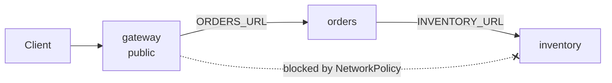

# k8s-microservices-deploy

[](https://github.com/Dev123dahiya/k8s-microservices-deploy/actions/workflows/ci.yml)

Three small services and the Helm chart that runs them on Kubernetes the way a production team would expect: health probes, graceful shutdown, least-privilege pods, autoscaling, disruption budgets and network policies. On every push, CI builds the image, starts a real cluster, installs the chart and proves that restarting a service drops no requests.

Services: Python standard library only. Chart tests: PyYAML. Python 3.10+.

## What runs



| Service | Does | If its dependency is down |
|---|---|---|
| `gateway` | Entry point; forwards `/orders/<id>` | Returns 502. The order is essential, so there is nothing useful to send |
| `orders` | Returns an order, asks inventory for each item's stock | Returns the order with `"in_stock": null` and `"degraded": true`. Stock is extra detail |
| `inventory` | Stock level per product | No dependencies |

The orders and stock records are a few sample entries held in memory. The services exist to give the deployment something real to run.

## What the chart sets up, per service

| Resource | Setting | Why |
|---|---|---|
| Deployment | `maxUnavailable: 0`, `maxSurge: 1` | A new pod must be ready before an old one is removed |
| | Readiness on `/readyz`, liveness on `/healthz` | Readiness fails during shutdown; liveness never checks dependencies, so one broken dependency cannot restart every pod |
| | `preStop: sleep`, then SIGTERM drains open requests | The pod keeps serving while it is removed from the Service's endpoints |
| | Non-root user, read-only filesystem, all capabilities dropped, no service-account token, seccomp `RuntimeDefault` | A compromised process gets as little as possible |
| | CPU and memory requests and limits | The scheduler can place pods; one leak cannot starve a node |
| Service | ClusterIP on a named port | Stable address for callers |
| HorizontalPodAutoscaler | CPU target; the Deployment omits `replicas` when it is on | Otherwise each `helm upgrade` would reset the scale |
| PodDisruptionBudget | `minAvailable: 1` | A node drain cannot take the last pod |
| NetworkPolicy | Ingress only from declared callers | `gateway` cannot reach `inventory` directly |

### One source of truth for the call graph

`values.yaml` declares who calls whom, once:

```yaml
services:
  gateway:   {module: services.gateway,   public: true,  upstreams: {ORDERS_URL: orders}}
  orders:    {module: services.orders,    public: false, upstreams: {INVENTORY_URL: inventory}}
  inventory: {module: services.inventory, public: false, upstreams: {}}
```

From each `upstreams` entry the templates generate both the caller's environment variable (`ORDERS_URL=http://<release>-orders:8080`) and the callee's NetworkPolicy rule. The URL and the firewall rule cannot drift apart, and a private service that nobody lists gets a policy with no rules, which denies all ingress.

## How it is verified

**Job 1, `test`** (no cluster): `helm lint` for all three value sets, then `pytest`.

| Check | Test |
|---|---|
| A request flows gateway to orders to inventory; 404s pass through unchanged | `test_request_flows_through_all_three_services`, `test_not_found_is_passed_through_...` |
| One request id appears in the response and in all three services' logs | `test_request_id_is_carried_across_every_hop_and_into_every_log` |
| Inventory down: degraded answer. Orders down: 502, and the gateway's own health checks stay green | `test_inventory_down_degrades_...`, `test_orders_down_is_a_502_...` |
| Readiness turns 503 once draining starts, while liveness stays 200 | `test_readiness_fails_while_draining_but_liveness_does_not` |
| Shutdown waits for a request in flight | `test_stop_waits_for_a_request_in_flight` |
| SIGTERM sent to the real process: logs the shutdown, exits 0 | `test_sigterm_on_the_real_process_logs_and_exits_zero` |
| Rendered chart, for default, dev and prod values: every selector matches its pods; pods are hardened; rollout settings leave time to drain; upstream URLs point at Services that exist and modules that exist | `tests/test_chart.py` |
| NetworkPolicies allow exactly the declared call graph, no more | `test_network_policies_allow_exactly_the_call_graph` |
| Autoscaler and fixed replicas never both set; the disruption budget is always below the minimum replica count | `test_autoscaler_and_fixed_replicas_never_fight`, `test_budget_never_blocks_a_node_drain` |

**Job 2, `cluster`** (a real Kubernetes cluster, [kind](https://kind.sigs.k8s.io/), inside the CI runner): builds the image, `helm install --wait`, then `scripts/cluster_test.py`:

1. A request through the gateway returns the order with stock levels from inventory.
2. From inside a `gateway` pod, a direct call to `inventory` is blocked; from an `orders` pod it succeeds.
3. While `orders` and then `inventory` are restarted with `kubectl rollout restart`, a client sends about ten requests a second through the gateway. The job fails if a single request fails or comes back degraded.

The badge at the top shows whether the latest run passed; the run's log has the request counts.

## Run it

```bash
pip install -e ".[dev]" && pytest -q          # chart tests need helm on PATH, otherwise they are skipped

docker build -t shop:ci .
kind create cluster --name shop && kind load docker-image shop:ci --name shop
helm install shop chart -n shop --create-namespace -f chart/values-dev.yaml --set image.tag=ci --wait
python3 scripts/cluster_test.py shop shop
```

`chart/values-prod.yaml` turns the autoscaler on (3 to 12 replicas) with larger limits and a longer drain.

## Layout

| Path | Contents |
|---|---|
| `services/common.py` | HTTP server with health endpoints, drain on SIGTERM, request ids, JSON logs |
| `services/{gateway,orders,inventory}.py` | The three services |
| `chart/` | Helm chart: Deployment, Service, HPA, PodDisruptionBudget, NetworkPolicy |
| `scripts/cluster_test.py` | End-to-end checks against a live cluster |
| `.github/workflows/ci.yml` | Both CI jobs |

## Limits

- The cluster in CI is a single-node kind cluster. It shows the chart installs and behaves correctly, not how it performs across nodes, zones or under real load.
- The autoscaler is rendered and schema-checked but never exercised: the CI cluster has no metrics server, so the dev values turn it off.
- The gateway's own rollout is not load-tested, because the test reaches it through `kubectl port-forward`, which is pinned to one pod. A real setup would put an Ingress or load balancer in front.
- All three services ship in one image and are chosen by command. Separate images per service would be usual once they have different dependencies.
- No TLS between services, no Ingress, no secrets, no persistent storage, and egress is not restricted by the network policies.
- The data is a handful of sample records in memory; there is no database.
